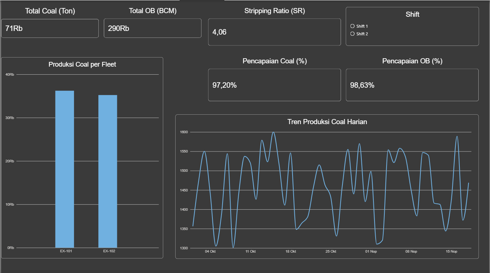

# ⛏️ Mining Operational Production Dashboard

An interactive Power BI dashboard designed to monitor and analyze mining operational performance, tracking coal production, overburden removal, stripping ratio, and target achievements in real-time.

---

## 📷 Dashboard Preview



---

## 🎯 Key Features & Metrics

- **Executive KPI Cards:** Quick overview of total Coal Production (Ton), Overburden Removal (BCM), Stripping Ratio (SR), and Target Achievement Rates.
- **Dynamic DAX Measures:**
  - **Stripping Ratio (SR):** Measures the ratio of Overburden removed to Coal extracted.
  - **Coal Achievement (%):** Evaluates actual coal production against target metrics.
  - **OB Achievement (%):** Tracks overburden removal efficiency against targets.
- **Fleet Performance Analysis:** Bar chart visualizing coal output across different fleet units (EX-101 vs EX-102).
- **Daily Production Trend:** Line chart displaying daily operational output over time.
- **Interactive Slicer:** Filter all metrics dynamically by shift (`Shift 1` & `Shift 2`).

---

## 📊 Dataset & Disclaimer

> **Note:** The dataset used in this project is a **dummy dataset** created specifically for simulation, modeling, and portfolio demonstration purposes. It contains fictional operational numbers representing typical daily mining outputs.

---

## 🧮 DAX Formulas Used

```dax
// 1. Stripping Ratio
Stripping Ratio = 
DIVIDE(
    SUM('Table3'[OB_Aktual_BCM]),
    SUM('Table3'[Coal_Aktual_Ton]),
    0
)

// 2. Coal Achievement (%)
Coal Achievement (%) = 
DIVIDE(
    SUM('Table3'[Coal_Aktual_Ton]),
    SUM('Table3'[Coal_Target_Ton]),
    0
)

// 3. OB Achievement (%)
OB Achievement (%) = 
DIVIDE(
    SUM('Table3'[OB_Aktual_BCM]),
    SUM('Table3'[OB_Target_BCM]),
    0
)

Tools & Technologies Used :

- Business Intelligence: Power BI Desktop

- Data Modeling & Analytics: DAX (Data Analysis Expressions)

- Design & Layout: Custom Dark Theme & Card Visuals
